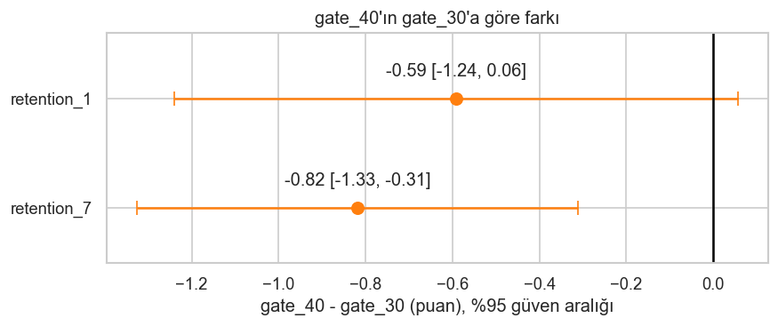

# Cookie Cats A/B Test: Should the First Gate Move from Level 30 to 40?

An end-to-end analysis of a real mobile-game A/B test (~90K players): experiment definition, data-quality checks, statistical testing, power analysis, and a product recommendation.

**Recommendation: keep the gate at level 30.** Moving it to level 40 lowered 7-day retention by 0.82 percentage points (−4.3% relative, p = 0.0016).



## Problem
In the mobile puzzle game *Cookie Cats*, players hit a progression gate that forces them to wait or make an in-app purchase. Players were randomly assigned at install to one of two versions:

| Group | Gate position | Players |
|---|---|---|
| `gate_30` (control) | Level 30 | 44,700 |
| `gate_40` (treatment) | Level 40 | 45,489 |

**Question:** Does moving the gate from level 30 to level 40 change player retention?

## Hypotheses & Metrics
| Role | Metric | Definition |
|---|---|---|
| Primary | `retention_7` | Player returned 7 days after install |
| Secondary | `retention_1` | Player returned 1 day after install |
| Guardrail | `sum_gamerounds` | Rounds played in the first 14 days |

H0: no difference between groups · H1: a difference exists (two-sided, α = 0.05).

7-day retention is the primary metric because most players have not reached the gate on day 1 (median player: 16 rounds in 14 days), so any gate effect is diluted in day-1 retention.

Data: [Cookie Cats dataset on Kaggle](https://www.kaggle.com/datasets/arpitdw/cokie-cats/data).

## Data Quality
- No missing values or duplicate users.
- **Sample ratio mismatch (SRM) detected:** χ² p ≈ 0.009 (49.6% / 50.4% split). The assignment mechanism is unknown, so the cause could not be determined; results are reported with this limitation.
- **One logging error removed:** a player with 49,854 rounds (≈3,500/day). Other high values are **kept**: `sum_gamerounds` is affected by the treatment, so trimming on it would introduce post-treatment bias and drop the players most exposed to the gate. Robust methods (median, Mann-Whitney U) are used instead.
- 3,994 players (~4.4%) never played a round; kept (intent-to-treat).
- The gate is placed by *level*, but the data only has total *rounds* (level ≤ rounds), so gate exposure is not directly observable.

## Methods
- **Retention (binary):** two-proportion z-test, Newcombe CI for the difference, Wilson CIs per group; cross-checked with χ² (χ² = z²) and a 5,000-resample bootstrap.
- **Game rounds (heavily skewed):** Mann-Whitney U, with probability of superiority as effect size; medians reported.
- **Multiple comparisons:** `retention_7` pre-specified as primary; Holm correction shown for robustness.
- **Power analysis:** minimum detectable effect (MDE) at 80% power, required sample sizes, and a 2,000-run simulation to validate the formulas.

## Results

| Metric | gate_30 | gate_40 | Difference (95% CI) | p | MDE (80% power) |
|---|---|---|---|---|---|
| **7-day retention (primary)** | 19.02% | 18.20% | **−0.82 pp** [−1.33, −0.31] · −4.3% relative | **0.0016** | 0.73 pp |
| 1-day retention | 44.82% | 44.23% | −0.59 pp [−1.24, +0.06] | 0.074 | 0.93 pp |
| Game rounds (median) | 17 | 16 | P(superiority) = 0.496 | 0.051 | — |

- **7-day retention:** moving the gate to level 40 significantly lowers retention. The bootstrap CI agrees ([−1.34, −0.32]) and the result survives Holm correction (p = 0.005). The experiment had ~88% power for an effect of this size.
- **1-day retention:** not significant, but the experiment was underpowered for an effect this small (~43% power; ~111K players per group would be needed). This means "not enough evidence", not "no effect".
- **Game rounds:** no practical difference. The gate position changed *whether* players came back, not *how much* they played.

## Recommendation
**Keep the gate at level 30.** A 4.3% relative drop in 7-day retention is material for a mobile game: at a hypothetical 100K daily installs, it means roughly 300–1,300 fewer players returning on day 7, every day. Keeping the current gate carries no cost, while moving it carries a demonstrated retention loss.

**Limitations:** the cause of the SRM is unknown; there is no revenue data, so a possible monetization benefit of a later gate cannot be measured; gate exposure (level) is not observable.

**Next experiments:**
1. **Early-game retention:** the median player plays only 16 rounds in 14 days, so most players churn before ever seeing the gate. One hypothesis for why gate 30 works better is that an earlier forced break delays boredom. A short, non-monetized break around level 10–15 would test this.
2. **Gate position with revenue:** re-run with revenue per player / LTV as the primary metric, retention as a guardrail, level-reach logging, and a pre-registered sample size.

## Repository Structure
```
notebooks/
  01_deney_tanimi_ve_veri_kontrolu.ipynb   experiment definition & data-quality checks
  02_kesifsel_analiz.ipynb                 exploratory analysis
  03_istatistiksel_testler.ipynb           statistical tests
  04_guc_analizi.ipynb                     power analysis
  05_sonuclar_ve_karar.ipynb               results & decision
figures/                                   exported charts
data/                                      dataset (not committed, see data/README.md)
```
Notebooks are written in Turkish; code and outputs are self-explanatory.

## How to Run
1. Download the dataset from [Kaggle](https://www.kaggle.com/datasets/arpitdw/cokie-cats/data) and place it in `data/` as `cookie_cats.csv` (see [data/README.md](data/README.md)).
2. Install dependencies and open the notebooks in order:
```
pip install -r requirements.txt
jupyter notebook notebooks/
```
Notebook 02 writes the cleaned dataset (`data/cookie_cats_clean.csv`) used by notebooks 03–05.
